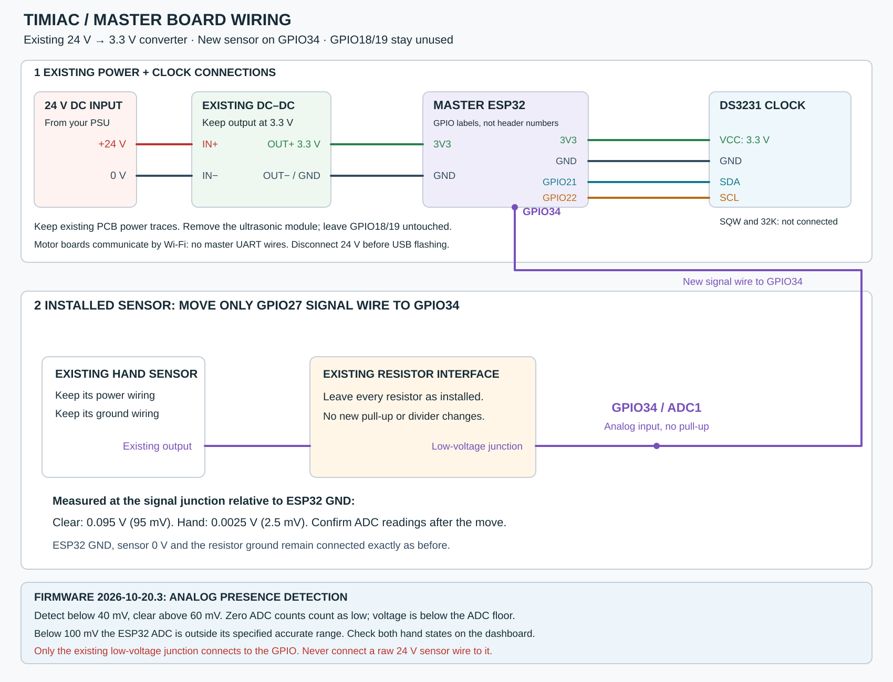

# Master board: analog hand sensor on GPIO34

**Firmware 2026-10-20.3 and later: move only the existing sensor signal wire from GPIO27
to GPIO34. Leave every resistor, sensor power connection and ground unchanged.**
GPIO34 is an input-only ADC1 pin, so analog sensing can run with the master's
Wi-Fi AP and router connection active. GPIO27 belongs to ADC2 and cannot provide
this analog measurement while Wi-Fi is running on the installed classic ESP32.



[Complete PNG](master-wiring.png) · [Sensor-only SVG](master-sensor-wiring.svg) ·
[Sensor-only PNG](master-sensor-wiring.png)

The diagrams show the installed resistor interface as a block. They specify
only the GPIO migration; they do not ask for the earlier proposed three-resistor
circuit to be installed. The actual reported measurements at GPIO27 relative
to ESP32 GND were **95 mV clear** and **2.5 mV with a hand**. This firmware follows
those measured states rather than inferring switching polarity from the NC label.

## Connections

| Connection | Destination |
|---|---|
| Existing 24 V input and DC converter | Keep unchanged; converter output stays 3.3 V |
| ESP32 / DS3231 supply | Existing 3.3 V and GND |
| DS3231 SDA / SCL | GPIO21 / GPIO22 |
| Installed resistor interface's low-voltage signal junction | GPIO34, previously GPIO27 |
| Sensor power, common ground and installed resistors | Keep unchanged |
| GPIO18 / GPIO19 ultrasonic traces | Unused |
| RTC SQW / 32K | Unconnected |
| Master to motor bridges | Wi-Fi; no master UART wiring |

GPIO numbers mean the board's GPIO labels, not header positions. Move the wire
with power off. Connect only the existing low-voltage signal junction, never a
raw 24 V sensor wire. The master and RTC stay on 3.3 V.

## Analog detection

The master configures ADC1 for 12-bit readings at 0 dB attenuation, takes nine
samples every 20 ms and uses their median to reject isolated spikes. There is
no sensor heap allocation in the sampling loop.

- Below **40 mV**: hand detected.
- Above **60 mV**: clear.
- Between 40 and 60 mV, including the boundaries: retain the last known state.
  Starting in this band does not establish a state or arm the gesture.
- A genuine **zero-count** ADC result counts as the low/detected state. The
  ESP32's calibrated conversion can return about 75 mV for zero counts; applying
  the 40 mV threshold to that result alone would never detect a grounded input.
  The dashboard labels this as **below the ADC floor**, not an exact 0 V.
- Invalid ADC reads and stale samples reset gesture arming. An invalid read is
  never interpreted as zero or as a hand.

**The ESP32's specified accurate ADC range starts at 100 mV at 0 dB.** The
requested 40/60 mV boundaries cannot be guaranteed as physical voltage thresholds
in this clipped region. This implementation is intended to distinguish the
reported 95 mV clear state from a near-ground hand state. If both return zero
counts on this particular ESP32, software cannot distinguish them: the gesture
will remain unarmed instead of triggering at boot. Inspect actual readings
before relying on it; median filtering cannot recover a clipped signal.

After homing, with a valid RTC and the release clock running, clear the sensor
continuously for **500 ms**, then present a hand for **200 ms**. This starts one
of seven random Struggle patterns and then returns to time. A held hand does
not repeat. Withdraw it after the animation to rearm. Motion, Stop, faults,
missing boards and a paused release clock discard gestures. The development
dashboard also supports gestures while idle and homed.

This is presence sensing, not a distance measurement or safety interlock.
A disconnected/grounded signal or sensor power failure can resemble a hand.

## Install and check

Only the master application and its dashboard need installation for this sensor
change. Pull the prepared images while online, connect the PC to Timiac Wi-Fi,
then run:

```powershell
python run.py master_release --host 192.168.4.1
```

Alternatively use Full update for the complete prepared package, or install the
master over USB with `python run.py master_release --port COM5` using its real
COM port. Keep the GPIO34 signal connected when checking the readings.

The local dashboard shows **Clear / Detected** plus estimated millivolts or
**below N mV**. Presence remains visible before homing and during movement;
that does not mean the gesture is eligible to run.

From **2026-10-20.4**, control.timiac.it also shows these readings, the current
blocked reason, last accepted Struggle time and last ignored hand event with
its reason. Sensor-triggered motion is identified separately from a manually
requested Struggle. Times use the clock's RTC and are labeled unavailable when
it is invalid. Counters/history in the panel cover the current master boot;
bounded `Hand sensor:` events also enter the persistent downloadable diagnostic
log. Held hands are recorded once, and repeated identical ignored log writes
are rate-limited. A brief accepted/ignored event remains visible after the hand
is withdrawn between cloud reports.

`/api/status` and downloaded diagnostics expose:

| `proximity` field | Meaning |
|---|---|
| `pin`, `inputMode` | 34, analog |
| `rawAdc` | Median 12-bit ADC count; zero means clipped near ground |
| `millivolts` | Calibrated estimate; null for zero-count, stale or invalid reads |
| `adcFloorMv` | Calibration's voltage for zero counts; not a precise minimum measurable voltage |
| `belowRange` | Reading is below the specified accurate range |
| `detectBelowMv`, `clearAboveMv` | 40 and 60 |
| `detected` | Presence state, or null when unknown/stale/invalid |
| `armed`, `ready`, `triggers` | Gesture eligibility and accepted trigger count |
| `blockedReason` | Why a gesture cannot currently start |
| `ignored`, `lastOutcome`, `lastReason` | Debounced ignored count and latest hand result |
| `lastTriggerTime`, `lastEventTime` | Retained local RTC timestamps, empty when unavailable |
| `lastTriggerAgeMs`, `lastEventAgeMs` | Ages when this status was created; null if no event |
| `lastTriggerId` | Accepted sensor program ID, for matching its motion result |

The legacy digital field `rawHigh` and distance fields stay null. Defaults are
`TIMIAC_PROXIMITY_PIN=34`, `TIMIAC_PROXIMITY_DETECT_MV=40` and
`TIMIAC_PROXIMITY_CLEAR_MV=60`. Disable gestures with
`TIMIAC_PROXIMITY_ENABLED=0` and rebuild when required.

Source: [Espressif ADC channels, limitations and measurement range](https://docs.espressif.com/projects/esp-idf/en/v4.4.7/esp32/api-reference/peripherals/adc.html).
